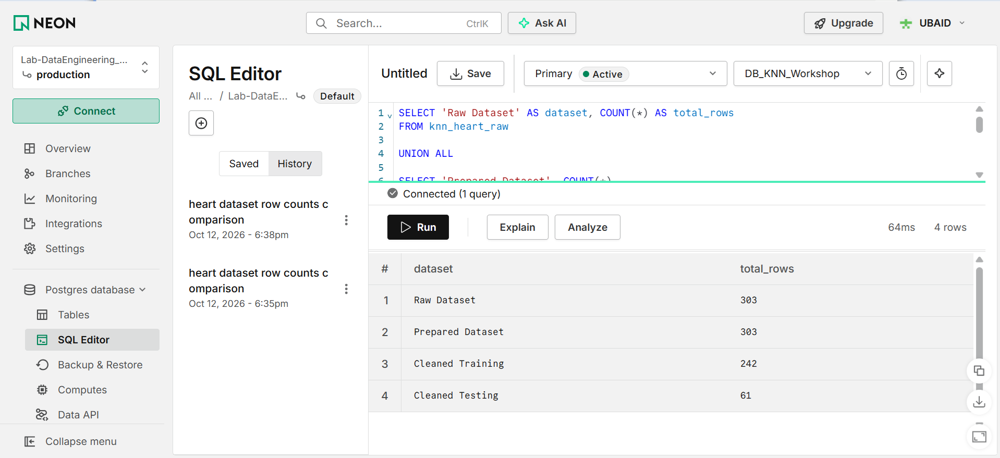

# K-Nearest Neighbors (KNN) Workshop

## Foundation of Machine Learning

**Team:** Team 2  
**Student Names and IDs:**
- Ubaid Ullah — 9110715
- Sukhchain Singh - 9111541
- Koushik Balne - 9087547
- Ved Vishal Patel - 9111628


**Workshop:** K-Nearest Neighbors Classification  
**Instructor:** Professor David Espinosa

---

## 1. Project Overview

This workshop explores the K-Nearest Neighbors (KNN) classification algorithm using the Iris dataset and a real-world Heart Disease dataset.

Our main project uses the UCI Heart Disease dataset to predict whether a patient has heart disease.

We performed data acquisition, exploratory data analysis (EDA), data cleaning, preprocessing, model training, evaluation, hyperparameter tuning, and feature engineering.

We also used object-oriented programming (OOP), sklearn Pipelines, CSV storage, and Neon PostgreSQL to create a reusable machine learning workflow.

## 2. Dataset

**Source:** UCI Machine Learning Repository  
**Dataset:** Heart Disease (ID 45)

**Dataset Details:**

- Total observations: 303
- Original input features: 13
- Missing feature values: 6
- Classification type: Binary classification

**Target Variable:**

- 0 = No Heart Disease
- 1 = Heart Disease

The dataset is downloaded programmatically using the `ucimlrepo` Python package.

## 3. Data Preprocessing

The following preprocessing steps were performed:

1. **Data Validation:** Checked required columns, missing values, target labels, and data structure.
2. **Train-Test Split:** Used an 80% training and 20% testing split with stratification.
3. **Missing Value Handling:** Used median imputation for numerical features and most-frequent imputation for categorical features.
4. **Feature Scaling:** Applied StandardScaler to numerical features.
5. **Categorical Encoding:** Applied OneHotEncoder to categorical features.
6. **Data Leakage Prevention:** Fitted preprocessing components only on training data using sklearn Pipelines.

The original 13 features were transformed into 28 numerical features for the baseline KNN model.

## 4. KNN Model Evaluation

The baseline model used K = 5, Euclidean distance, and uniform neighbor weights.

### Test Results

| Metric | Baseline KNN (K=5) | Tuned KNN (K=3) |
|---|---|---|
| Accuracy | 88.52% | 86.89% |
| Precision | 86.21% | 81.25% |
| Recall | 89.29% | 92.86% |
| F1-score | 87.72% | 86.67% |

### Hyperparameter Tuning

We used GridSearchCV with 5-fold stratified cross-validation to compare different values of K and neighbor weighting methods.

The best configuration based on cross-validation F1-score was K = 3 with uniform weighting.

The tuned model improved test recall but did not improve test accuracy or F1-score compared with the baseline.

## 5. Feature Engineering

We created two simple binary features:

- **bp_140_or_higher:** Indicates whether resting blood pressure is at least 140.
- **chol_240_or_higher:** Indicates whether cholesterol is at least 240.

These features were implemented using a reusable sklearn-compatible OOP transformer.

### Cross-Validation Comparison

| Model | Mean CV F1-score |
|---|---|
| Baseline KNN (13 features) | 79.89% |
| Feature-Engineered KNN (15 features) | 74.32% |

The baseline model performed better. This experiment demonstrated that adding features does not always improve classification performance.

## 6. Object-Oriented Project Architecture

The project is organized into reusable Python modules.

| Module | Responsibility |
|---|---|
| `src/data_acquisition.py` | Download and validate UCI Heart Disease data |
| `src/preprocessing.py` | Validate, split, impute, scale, and encode data |
| `src/knn_model.py` | Train and evaluate KNN |
| `src/feature_engineering.py` | Create additional features |
| `src/csv_storage.py` | Save and verify local CSV datasets |
| `src/neon_store.py` | Manage Neon PostgreSQL connection |
| `src/neon_persistence.py` | Upload and verify datasets in Neon |

The sklearn Pipeline Pattern is used to connect preprocessing and model training while preventing data leakage.

## 7. Data Storage

### Local CSV Files

Four datasets are saved in the `data/` directory:

| File | Rows | Columns |
|---|---|---|
| `heart_disease_raw.csv` | 303 | 14 |
| `heart_disease_prepared.csv` | 303 | 15 |
| `heart_train_cleaned.csv` | 242 | 30 |
| `heart_test_cleaned.csv` | 61 | 30 |

The raw and prepared datasets preserve missing values. The cleaned training and testing datasets contain the transformed features from the fitted baseline preprocessing pipeline.

### Neon PostgreSQL

The project uses a remote Neon PostgreSQL database named `DB_KNN_Workshop`.

Four database tables were created and verified:

- `knn_heart_raw`
- `knn_heart_prepared`
- `knn_heart_train_cleaned`
- `knn_heart_test_cleaned`

All four dataset tables were successfully uploaded and verified against the local CSV files.

### Database Verification Evidence



## 8. Installation and Setup

### Step 1: Clone the Repository

```bash
git clone https://github.com/UbaidUllah777/KNearestNeighbors_Workshop.git
cd KNearestNeighbors_Workshop
```


### Step 2: Create a Virtual Environment

```bash
python -m venv .venv
```

Activate it on Windows PowerShell:

```powershell
.\.venv\Scripts\Activate.ps1
```

### Step 3: Install Dependencies

```bash
python -m pip install -r requirements.txt
```

### Step 4: Configure Neon PostgreSQL

Create a `.env` file in the project root containing:

`Note: For professor i will send env zip file in email , please paste in in root folder after extracting the env zip file`

```dotenv
DATABASE_URL=your_neon_postgresql_connection_string
```

A valid Neon connection is required to run the database integration cells.

The `.env` file is excluded from Git version control and must never be uploaded to GitHub.

### Step 5: Run the Notebook

Open:

`KNN_Workshop_Solution.ipynb`

Select the project's Python environment as the notebook kernel.

Restart the kernel and execute all cells in order.

Internet access is needed for UCI data acquisition, and a working Neon database connection is needed for the database cells.

The notebook will recreate the local CSV snapshots and update the four dedicated Neon workshop tables.

## 9. Peer Project Comparison

We reviewed Team 5's published KNN workshop.

Team 5 used weather data to classify rainy and non-rainy conditions, while our team used the Heart Disease dataset.

Their test accuracy was 97.06%, compared with our 88.52%. However, their test F1-score was 66.67%, compared with our 87.72%.

The projects use different datasets and classification tasks, so the results are not directly comparable as a ranking.

The notebook contains a detailed GitHub-based comparison and our workshop reflections.

**Team 5 Repository:**  
https://github.com/AlamirConestoga/KNearestNeighbors_Workshop-main

## 10. Key Learning Outcomes

Through this workshop, we learned how to:

- Apply KNN to a real-world classification problem.
- Perform data preprocessing using sklearn Pipelines.
- Prevent data leakage during training and cross-validation.
- Evaluate models using accuracy, precision, recall, F1-score, and confusion matrices.
- Compare hyperparameters using GridSearchCV.
- Test whether feature engineering improves performance.
- Organize machine learning code using OOP.
- Store datasets locally and in a remote PostgreSQL database.

## 11. Limitations

The Heart Disease dataset contains only 303 observations. The reported results may vary with other datasets or train-test splits.

This workshop is for educational purposes. The model is not validated for medical diagnosis or clinical decision-making.

## 12. References

- UCI Machine Learning Repository — Heart Disease Dataset: https://archive.ics.uci.edu/dataset/45/heart+disease
- Scikit-learn Documentation: https://scikit-learn.org/stable/
- Neon PostgreSQL: https://neon.com/
- Instructor's KNN Workshop: https://github.com/ProfEspinosaAIML/KNearestNeighbors_Workshop
